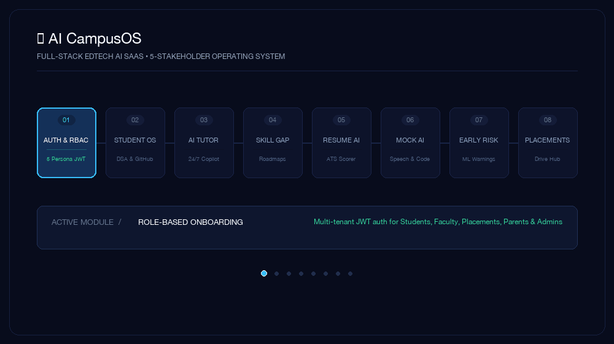
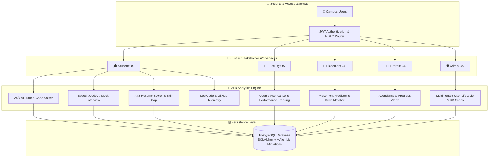

# 🎓 AI CampusOS

<p align="center">
  
</p>

<p align="center">
  <strong>Enterprise EdTech AI SaaS • 5-Stakeholder Operating System • Autonomous Academic & Career Copilot</strong><br>
  A production-ready full-stack campus intelligence platform connecting Students, Faculty, Placement Officers, Parents, and Admins with real-time academic tracking, 24/7 AI tutoring, DSA/GitHub audits, and autonomous career preparation.
</p>

<p align="center">
  
  
  
  
  
  
  
  
  
</p>

---

## 🎯 What it does

**AI CampusOS** modernizes higher education infrastructure by replacing fragmented legacy portals (ERP, LMS, and placement sheets) with a unified, AI-driven operating system. It features **5 customized role-based experiences** designed to eliminate administrative blind spots, accelerate student hiring outcomes, and provide personalized 24/7 academic support.

### ⚡ Legacy University Portals vs. AI CampusOS

| Dimension | Legacy University Systems | AI CampusOS |
|---|---|---|
| **Stakeholder Access** | Disjointed portals, separate logins for fees, exams & placements | **Unified Multi-Tenant RBAC:** Custom dashboards for Students, Faculty, Placements, Parents & Admins |
| **Academic Assistance** | Limited to office hours and scheduled lectures | **24/7 AI Academic Tutor:** Syllabus-grounded Q&A, step-by-step problem solver & code debugging |
| **Placement Preparation** | Manual resume formatting & mock interview queues | **Autonomous AI Career Suite:** ATS resume audit, real-time speech/code mock interviews & STAR feedback |
| **Skill Validation** | Self-reported skills on paper resumes | **Automated Profile Verification:** Live GitHub repo analysis and LeetCode DSA telemetry |
| **Student Risk Tracking** | Manual attendance sheets; failures discovered after exam results | **Proactive At-Risk ML Engine:** Early warning alerts detecting academic drop-offs weeks before exams |
| **Placement Operations** | Spreadsheets, manual email chains & criteria verification | **End-to-End Drive Hub:** Auto-filters eligible candidates, schedules rounds & tracks offer conversions |

---

## 👥 5-Stakeholder Persona Architecture



---

## 🛠️ Pipeline Modules & Engineering Breakdown

| Module | Location | Responsibilities |
|---|---|---|
| **1. Auth & RBAC** | `backend/app/routes/auth.py` | Multi-persona JWT authentication, refresh token rotation, password recovery, and role-enforced dependency injection. |
| **2. 24/7 AI Academic Tutor** | `backend/app/services/tutor_ai_service.py` | Curriculum-grounded AI copilot answering technical questions, generating practice problems, and explaining lecture concepts. |
| **3. AI Mock Interviewer** | `backend/app/services/interview_service.py` | Voice and text interview simulator evaluating student responses using the STAR method (Situation, Task, Action, Result) with real-time scoring. |
| **4. ATS Resume Analyzer** | `backend/app/services/resume_service.py` | Parses student resumes, performs structural audits, computes ATS match percentages, and injects high-impact missing industry keywords. |
| **5. Skill-Gap & Career Roadmaps** | `backend/app/routes/ai.py` | Benchmarks student proficiencies against target tier-1 company job descriptions to generate step-by-step personalized skill roadmaps. |
| **6. Coding & DSA Sync** | `backend/app/services/leetcode_service.py` | Syncs live LeetCode problem breakdown (Easy, Medium, Hard) and GitHub repositories to objectively evaluate coding prowess. |
| **7. At-Risk Student Prediction** | `backend/app/services/prediction_service.py` | ML algorithms correlating low attendance, declining quiz scores, and lab inactivity to alert faculty before semester failure. |
| **8. Placement Drive Orchestrator** | `backend/app/routes/placement.py` | Manages corporate hiring drives, automatically filters eligible candidates by CGPA/backlog criteria, and tracks offer rollouts. |

---

## 🚀 Quick Start

### Option A: Launch with Docker Compose (Recommended)

Run the entire full-stack platform (React Frontend + FastAPI Backend + PostgreSQL Database) with a single command:

```bash
git clone https://github.com/Arunlucky2610/AICampusOs.git
cd AICampusOs

# Build and start all services
docker compose up --build -d

# Seed demo users and mock campus records
docker compose exec backend python -m app.seed
```

Access the application:
* **Frontend Web App:** [http://localhost:5173](http://localhost:5173)
* **Backend API Docs:** [http://localhost:8000/docs](http://localhost:8000/docs)

---

### Option B: Local Manual Setup

#### 1. Backend Setup (FastAPI & PostgreSQL)

```bash
cd backend

# Create and activate Python virtual environment
python3 -m venv .venv
source .venv/bin/activate       # On Windows: .\.venv\Scripts\activate

# Install dependencies
pip install -r requirements.txt

# Configure environment
cp .env.example .env

# Run Alembic migrations and seed demo data
python -m app.seed

# Start FastAPI server
uvicorn app.main:app --reload --host 0.0.0.0 --port 8000
```

#### 2. Frontend Setup (React & Vite)

```bash
cd ../frontend

# Install dependencies
npm install

# Configure environment
cp .env.example .env

# Start Vite dev server
npm run dev
```

Open **[http://localhost:5173](http://localhost:5173)** in your browser.

---

## 🔑 Demo Credentials

The platform comes pre-seeded with 5 comprehensive stakeholder accounts to test all role-based experiences immediately:

| Persona | Role | Email | Password | Primary Capabilities |
|---|---|---|---|---|
| **Admin** | Super Admin | `admin@aicampusos.com` | `Campus@123` | Institutional settings, user lifecycle, system audit |
| **Student** | Student | `student@aicampusos.com` | `Campus@123` | AI Tutor, Mock Interviews, Resume Audit, DSA Tracker |
| **Faculty** | Professor | `faculty@aicampusos.com` | `Campus@123` | Class performance telemetry, at-risk early alerts |
| **Placement** | Placement Officer | `placement@aicampusos.com` | `Campus@123` | Drive creation, student eligibility filtering, hiring analytics |
| **Parent** | Guardian | `parent@aicampusos.com` | `Campus@123` | Real-time attendance, fee receipts, placement status |

---

## 📡 API Endpoints Overview

### Authentication & User Lifecycle
* `POST /api/auth/login` — Authenticate and receive JWT access & refresh tokens
* `POST /api/auth/register` — Create a new student or faculty account
* `GET  /api/auth/me` — Retrieve current authenticated profile & role permissions
* `POST /api/auth/refresh-token` — Rotate access token via valid refresh token

### Persona Dashboards
* `GET  /api/student/dashboard` — Aggregated student telemetry, attendance & upcoming drives
* `GET  /api/faculty/dashboard` — Assigned courses, class attendance & at-risk student lists
* `GET  /api/placement/dashboard` — Corporate drive pipeline, conversion metrics & hiring rates
* `GET  /api/parent/dashboard` — Ward attendance, academic grades & placement eligibility
* `GET  /api/admin/dashboard` — Global institution metrics, faculty-student ratios & server health

### AI & Intelligence Engines
* `POST /api/ai/assistant` — Contextual campus chatbot assistant
* `GET  /api/ai/skill-gap` — Target company benchmark vs candidate skill gap analysis
* `POST /api/ai/resume-analysis` — Full ATS resume grading and structural keyword injection
* `GET  /api/ai/placement-prediction` — ML placement readiness score based on academic & coding records
* `GET  /api/ai/risk-prediction` — Early warning system detecting at-risk academic drop-offs
* `GET  /api/ai/learning-roadmap` — Personalized step-by-step topic mastery schedule

---

## 📁 Project Directory Structure

```text
AICampusOs/
├── backend/
│   ├── app/
│   │   ├── core/                  # Security, JWT tokens & configuration
│   │   ├── dependencies/          # Role-based route protectors
│   │   ├── models/                # SQLAlchemy models (Users, Courses, Drives, AI Sessions)
│   │   ├── routes/                # FastAPI routers (auth, student, faculty, ai, placement)
│   │   ├── schemas/               # Pydantic data validation schemas
│   │   ├── services/              # AI tutor, speech interview, resume & prediction engines
│   │   └── utils/                 # Formatting, caching & database helpers
│   ├── alembic/                   # Database schema migrations
│   ├── seed.py                    # Comprehensive demo campus seeder
│   └── requirements.txt           # Python dependencies
├── frontend/
│   ├── src/
│   │   ├── api/                   # Axios client & typed API endpoints
│   │   ├── components/            # Reusable UI widgets, particles & tables
│   │   ├── layouts/               # Role-based shell layouts with responsive sidebars
│   │   ├── pages/                 # Full-page dashboards (AiTutor, MockInterview, Placements)
│   │   └── types/                 # TypeScript interfaces for campus entities
│   ├── package.json               # Frontend dependencies & scripts
│   └── tailwind.config.js         # Styling configuration & dark mode tokens
├── assets/                        # Animated walkthrough GIFs & banners
├── docker-compose.yml             # Multi-container orchestration (App + Postgres)
└── README.md
```

---

## 👨‍💻 Author

**Arun Sudhaveni** · Computer Science Engineering  
*CMR Technical Campus (CMRC)*

[](https://github.com/Arunlucky2610)
[](https://linkedin.com)

`Full-Stack AI` · `Autonomous Systems` · `FastAPI & React` · `PostgreSQL` · `EdTech SaaS`
